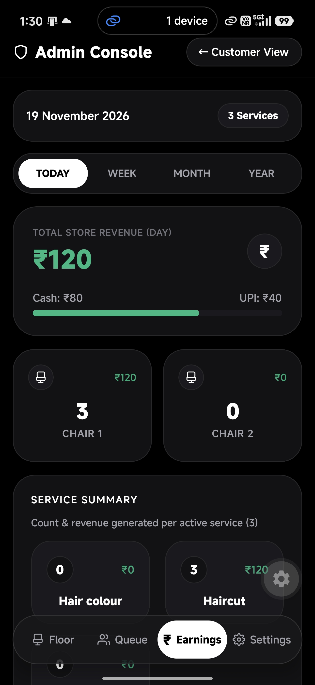
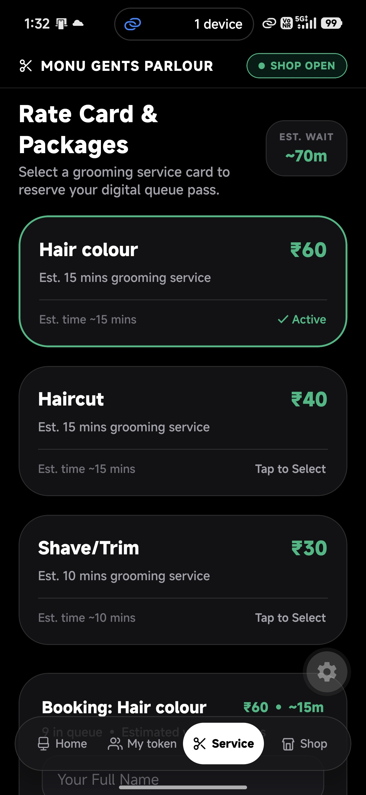
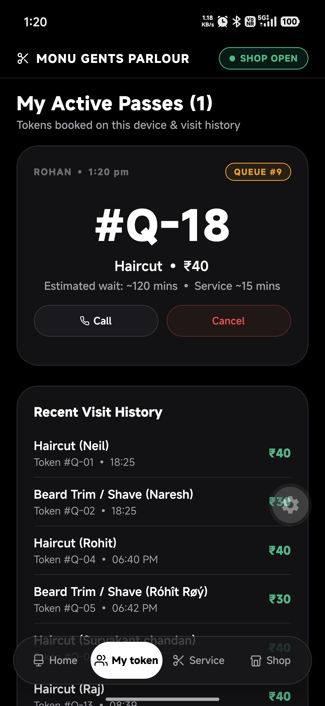

# Monu Gents Parlour — Real-Time Queue & Salon Management App

A real-time **React Native (Expo) + TypeScript + Firebase Firestore** queue, 2-chair floor control, rate card, and revenue reporting application built for **Monu Gents Parlour** (Azadnagar, Gomoh, Dhanbad, Jharkhand).

- **Live Web App:** [https://monu-gents-parlour-6skd42rlb-work-sphere6.vercel.app](https://monu-gents-parlour-6skd42rlb-work-sphere6.vercel.app)
- **GitHub Repository:** [https://github.com/rajmahto/monu-gents-parlour](https://github.com/rajmahto/monu-gents-parlour)

---

## System Architecture

```text
+-------------------------------------------------------------------+
|                        CLIENT LAYER (Expo)                        |
|                                                                   |
|   +---------------------------+   +---------------------------+   |
|   |       CUSTOMER VIEW       |   |       OWNER CONSOLE       |   |
|   |  - Home (2 Chairs + Wait) |   |  - Floor (2-Chair Billing)|   |
|   |  - Services (Rate Card)   |   |  - Queue (Walk-In + Seat) |   |
|   |  - My Token (Pass + Rate) |   |  - Earnings (CSV Export)  |   |
|   |  - Store & Directory      |   |  - Settings (Rates/Phone) |   |
|   +-------------+-------------+   +-------------+-------------+   |
|                 |                               |                 |
|                 +---------------+---------------+                 |
|                                 |                                 |
|             +-------------------+-------------------+             |
|             |       SalonContext (State Layer)      |             |
|             |  - YYYY-MM-DD daily reset & guards  |             |
|             |  - 2-chair & queue wait estimator   |             |
|             +---------+-------------------+---------+             |
|                       |                   |                       |
|    Local Device Storage                   Realtime Cloud Sync       |
|  (@react-native-async-storage)          (Firebase Firestore)      |
+-----------------------+-------------------+-----------------------+
                        |                   |
                        v                   v
            +-----------------------+   +-----------------------+
            |  Per-Device Token IDs |   |   Firestore Collections|
            |  & Dismissed Cards    |   | - bookings            |
            +-----------------------+   | - services            |
                                        | - earnings            |
                                        | - reviews             |
                                        | - settings/salonData  |
                                        +-----------------------+
```

### How Data Flows

1. **Realtime Sync (`onSnapshot`):** `SalonContext` listens to `bookings`, `services`, `earnings`, `reviews`, and `settings/salonData` in Firebase Firestore so customer and owner screens stay updated without manual refresh.
2. **Per-Device Pass Scoping:** Customer token IDs and dismissed completed cards are persisted locally on the customer's device via `AsyncStorage` so each phone only sees its own active pass (`#Q-01`, `#Q-02`, ...), while the owner sees the full live queue.
3. **Date-Scoped Daily Operations:** Tokens and daily counters (`#Q-01` onwards) are scoped by local date (`YYYY-MM-DD`), keeping each day's queue clean and preventing duplicate active tokens for the same phone number on the same day.
4. **Smart Estimated Wait Time:** Calculated dynamically using active chair occupancy (`Chair 01` & `Chair 02`), ahead-of-line queue position, and service durations.

---

## Key Features

### Customer Experience

- **Live Chairs & Wait Time (`Home` & `Services`):** Check whether Chair 1 and Chair 2 are vacant or occupied, see current queue count, and view live estimated wait time before booking.
- **Service Selection & Token Booking (`Services`):** Browse active services with pricing and estimated duration, enter name and 10-digit mobile number, and generate a queue token.
- **Personal Token Pass (`My Token`):** Track queue position, live estimated wait, call the salon, cancel a waiting token, submit star ratings/feedback, or dismiss completed cards (`✕`).
- **Store & Directory (`Store`):** View salon address, hours, editable contact number, parlour photo gallery (with camera/gallery upload), ratings summary, and links for Google Maps, Instagram, and YouTube.
- **Hindi & English Support:** Switch between English and Hindi (`हिंदी`).

### Owner Admin Console

- **2-Chair Command Center (`Floor`):** Toggle shop open/closed status (`isOnline`), view active customers on Chair 01 and Chair 02, edit final prices, pick `CASH` or `UPI`, and mark services complete.
- **Walk-In & Queue Control (`Queue`):** Generate walk-in tokens with active service selection (`OwnerWalkInCard`), check queue position and wait estimates, call customers, skip/no-show, or seat customers on Chair 1 or Chair 2.
- **Earnings & Multi-Period Reports (`Earnings`):** View revenue across `TODAY`, `WEEK`, `MONTH`, and `YEAR` with Cash/UPI split, per-chair counts/revenue, dynamic **Service Summary** based on active services, ledger history, and CSV report export (including month-wise and year-wise summaries).
- **Rate Card & Shop Settings (`Settings`):** Add new services, adjust prices (`-` / `+`), delete services, update salon contact number, update social/map links, manage hero portrait, and change admin password.

---

## Screenshots

### Owner Console — Earnings & Dynamic Service Summary


### Owner Console — Rate Card & Active Services


### Customer — Active Passes & Rating Card


---

## Folder Structure

```text
monu-gents-parlour/
├── app/                          # App routes / entry screens (Expo Router / layout)
├── assets/                       # Static app icons, splash screen, and media
├── components/
│   ├── common/                   # Shared UI helpers & icons (e.g., ChatIcon.tsx)
│   ├── customer/
│   │   ├── CustomerBottomNav.tsx # Customer bottom tab bar
│   │   ├── CustomerView.tsx      # Customer view container & tab switcher
│   │   ├── details.tsx           # Store info, gallery, ratings & social links
│   │   ├── home.tsx              # Hero banner, 2-chair status & live wait time
│   │   ├── services.tsx          # Rate card selection & token booking form
│   │   └── token.tsx             # Active token pass, wait time, cancel & review
│   └── owner/
│       ├── earnings.tsx          # Period filters, dynamic service summary & CSV export
│       ├── floor.tsx             # Shop open/close switch & 2-chair billing modal
│       ├── OwnerBottomNav.tsx    # Owner bottom tab bar
│       ├── OwnerPanel.tsx        # Owner console container
│       ├── queue.tsx             # Walk-in card, live waiting queue & seat controls
│       ├── rates.tsx             # Rate management view (if used separately)
│       ├── settings.tsx          # Language, contact number, services, links & password
│       └── WalkInCard.tsx        # Walk-in token generator with service chips
├── config/
│   └── firebase.ts               # Firebase initialization & Firestore db export
├── constants/
│   └── theme.ts                  # Light & dark theme color tokens
├── context/
│   └── SalonContext.tsx          # Global store, Firestore listeners & business logic
├── types/
│   └── database.ts               # TypeScript interfaces for Booking, ServiceItem, etc.
├── package.json
└── README.md
```

---

## Local Setup & Installation

1. **Clone the repository:**
   ```bash
   git clone https://github.com/rajmahto/monu-gents-parlour.git
   cd monu-gents-parlour
   ```

2. **Install dependencies:**
   ```bash
   npm install
   ```

3. **Configure Firebase Firestore:**
   Update `config/firebase.ts` with your Firebase project credentials and ensure Firestore is enabled in the Firebase Console.

4. **Run the project:**
   ```bash
   npx expo start
   ```
   - Press `w` to open in the web browser.
   - Scan the QR code with **Expo Go** to test on an Android/iOS device.

---

## Owner Handover Guide (For Monu Bhaiya)

1. **Opening & Closing the Shop:** Use the **Shop OPEN / CLOSED** toggle on **Floor** or **Settings** to pause or resume new online bookings anytime.
2. **Managing Tokens & Chairs:**
   - Online customers get a token (`#Q-01`, `#Q-02`, ...) and appear in **Queue**.
   - Walk-in customers can be added directly from **Queue** using **WalkInCard** by selecting their service and entering their name.
   - Tap **Seat Chair 1** or **Seat Chair 2** to move a customer onto a chair.
   - Once grooming is done, go to **Floor**, verify/edit the amount, select **CASH** or **UPI**, and tap **Mark Service Complete & Save**.
3. **Updating Rates, Phone Number & Links:** Go to **Settings** to add/edit/delete services, update the salon contact number, change Google Maps / Instagram / YouTube links, or change the admin password.
4. **Downloading Earnings Reports:** Open **Earnings**, choose `TODAY`, `WEEK`, `MONTH`, or `YEAR`, and tap **Export Excel** to download a `.csv` file with transaction rows plus month-wise and year-wise summaries.
